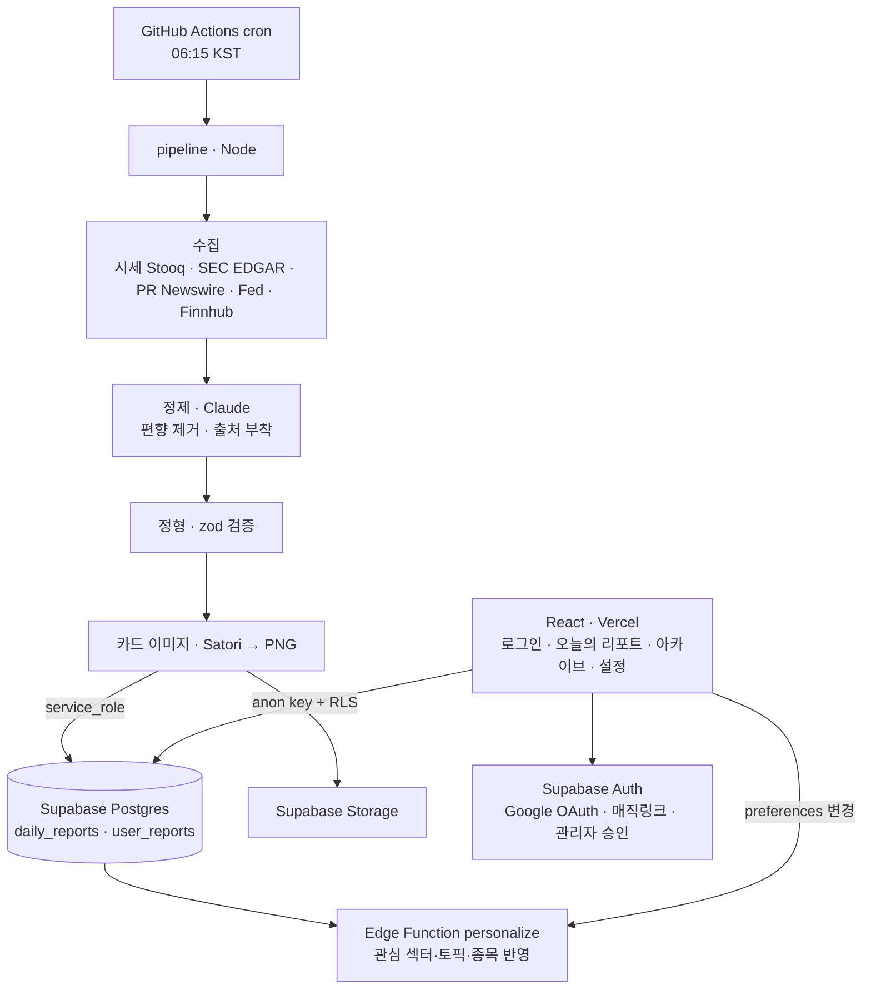

# 📈 Daily Stock Report

매일 오전 **06:15 (Asia/Seoul)** 미국 증시 동향과 공신력 있는 최신 보도자료를 자동 수집하고,
**정치 성향을 제거한 팩트 기반**으로 정리해 **시각화된 리포트**를 **인증된 사용자**에게 제공하는 서비스입니다.

- 팩트만: 모든 항목에 **출처 링크** 부착, 정치적 논평·추측 제거 (Claude)
- 개인화: 사용자가 **관심 섹터·토픽·종목**을 선택
- 시각화: 인터랙티브 차트(Recharts) + 공유용 리포트 카드 이미지(Satori→PNG) + AI 헤더(옵션)
- 인증: Supabase Auth (Google OAuth + 매직링크) + **관리자 승인 게이트**
- 전부 **무료 티어**: Vercel + Supabase + GitHub Actions

---

## 아키텍처



## 모노레포 구조

```
apps/web/                React + Vite + Tailwind + Recharts (프론트)
packages/shared/         리포트 zod 스키마 · 소스 어댑터 · Claude LLM · 개인화 로직
packages/pipeline/       매일 실행되는 수집·정제·생성 Node 파이프라인
supabase/migrations/     스키마 + RLS + 트리거
supabase/functions/      personalize (Deno Edge Function)
.github/workflows/       finalize.yml (reports/report.json push 시 발화)
DEVELOPMENT_PROMPT.md    전체 설계 명세
```

---

## 로컬 개발

```bash
npm install

# 프론트 개발 서버 (apps/web/.env.local 필요)
npm run dev

# 전체 타입체크 / 빌드
npm run typecheck
npm run build
```

`apps/web/.env.local` (예시는 `apps/web/.env.example`):
```
VITE_SUPABASE_URL=...
VITE_SUPABASE_ANON_KEY=...
```

---

## 배포 (무료 티어)

### 1) Supabase
1. 프로젝트 생성.
2. 마이그레이션 적용: `supabase db push` (또는 대시보드 SQL 에디터에 `supabase/migrations/*.sql` 순서대로 실행).
3. Auth → Google Provider 활성화, 리다이렉트 URL에 Vercel 도메인 + `http://localhost:5173` 추가.
4. Edge Function 배포: `supabase functions deploy personalize`.
5. Function 환경변수 설정: `SUPABASE_URL`, `SUPABASE_ANON_KEY`, `SUPABASE_SERVICE_ROLE_KEY`.
6. 첫 관리자 지정: `update public.profiles set role='admin', is_approved=true where email='you@example.com';`

### 2) Vercel (프론트)
1. 저장소 연결, Root Directory = `apps/web`.
2. 환경변수 `VITE_SUPABASE_URL`, `VITE_SUPABASE_ANON_KEY` 설정.
3. 배포 후 도메인을 Supabase Auth 리다이렉트 URL에 등록.

### 3) GitHub Actions (스케줄러)
저장소 **Secrets**에 등록:
```
SUPABASE_URL, SUPABASE_SERVICE_ROLE_KEY, ANTHROPIC_API_KEY
FINNHUB_API_KEY (선택), ALPHAVANTAGE_API_KEY (선택)
```
리포트 발행은 Claude Routine이 매일 05:50 KST에 `reports/report.json`을 push하면
`finalize.yml`이 자동으로 KIS 시세 앵커링 + 이미지 + Supabase 적재를 처리한다.
수동 스모크 테스트는 `Actions → finalize-report → Run workflow` (현재 report.json으로 재적재).
자세한 내용은 `docs/HANDOFF.md` §5 참고.

---

## 데이터 소스 (무료 API + 공신력 RSS)

- **시세**: Stooq(키 불필요) 기반 지수 종가. 소스별 실패는 무시하고 계속 진행.
- **뉴스/보도자료**: SEC EDGAR(8-K), PR Newswire, Federal Reserve, Finnhub(company news). 키가 없는 소스는 자동 skip.
- 소스는 `packages/shared/src/sources/`의 `SourceAdapter` 패턴으로 추가/제거.

> 각 사실에는 반드시 출처가 붙습니다. 출처 없는 항목·원문에 없는 수치는 파이프라인에서 제거됩니다.

## 보안 · 컴플라이언스

- 비밀키는 서버(Edge Function / GitHub Secrets)에만. 프론트는 `anon key`만 노출.
- **RLS 이중 방어**: 미승인 사용자는 프론트 가드를 우회해도 어떤 리포트 row도 읽을 수 없음.
- 기사 전문 재배포 금지 — 사실 요약 + 원문 링크만 제공.
- 모든 리포트에 투자 면책 고지 포함.

## 상태

스캐폴딩 완료 — 전 패키지 타입체크 통과, 프론트 프로덕션 빌드 성공. 배포 시 위 3단계 설정 후 동작합니다.
자세한 설계는 [`DEVELOPMENT_PROMPT.md`](./DEVELOPMENT_PROMPT.md) 참고.
